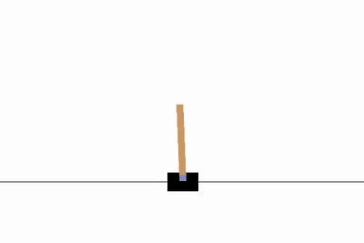

# Solving Problems with Reinforcement Learning

A repository of problems solved by **reinforcement learning**: instead of being given instructions, a computer tries things, gets a score, and gradually works out what succeeds.

## Problem 1: Keeping a pole balanced

A pole is hinged on top of a moving cart. Left alone, it falls over in well under a second. The computer can only push the cart left or right, and it starts knowing nothing about how to do this.



**Result:** at the start the pole falls after roughly 16 moves on average. After about 360 practice attempts, the computer keeps it up for around 445 of a possible 500 moves. The clip above is the trained computer in action.

The same kind of problem (making a series of decisions where each choice affects the next, and learning from the outcome) shows up in robotics, scheduling and many other settings. The pole is a small, clear version of it.

**[See the full write-up and code →](solving-cartepole-with-reinforce)**

## Run it yourself

Requires Python 3.11 and [uv](https://docs.astral.sh/uv/):

```bash
uv sync
uv run jupyter lab
```

Then open the notebook in `solving-cartepole-with-reinforce/` and run all cells.
