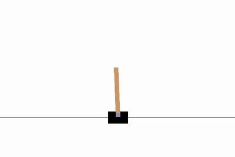
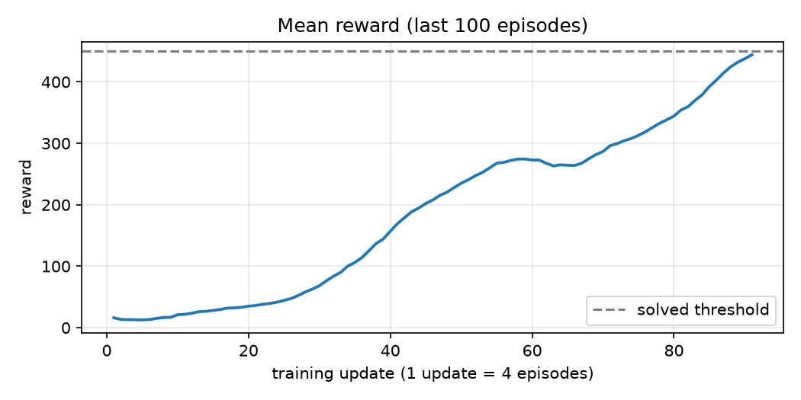

# Teaching a Computer to Balance a Pole

## The problem

A pole is hinged on top of a cart. Left alone, it tips over almost immediately. The only thing the computer can do is push the cart left or right, and it earns one point for every moment the pole stays up. The best possible score in one attempt is 500.

At the start the computer knows nothing. It pushes at random, and the pole falls after about 20 moves.

## The result



This is the trained computer in action. The average score over its most recent 100 attempts rose from about 16 to about 445 out of 500 after 91 rounds of learning (364 practice attempts), so the pole is usually kept up for almost the full time.

## How the computer learns

1. **Try.** It plays four attempts, choosing pushes with some randomness.
2. **Score.** Each push is credited with the points that followed it, so a push early in a long, successful attempt counts for a lot.
3. **Adjust.** It makes pushes that led to long attempts more likely, and pushes that led to early falls less likely.
4. **Repeat** until the average score is consistently above 450.

No one tells it how to balance the pole. It finds out from the score alone.

## Why it matters

Many real problems have the same shape: a series of decisions, each affecting the next, with feedback only on how things turned out (a robot arm moving, a warehouse being restocked, a schedule being filled). Balancing a pole is the simplest clear example of learning to decide from a score.

---

# Technical details

## Method

This project uses **REINFORCE**, a policy-gradient method that learns a policy `π(a | s)` directly, with no value function:

1. Play `EPISODES_TO_TRAIN` (4) complete episodes by sampling actions from the current policy.
2. For every step compute the discounted return `G_t = r_t + γ · G_{t+1}`.
3. Standardize the returns across the batch (zero mean, unit variance). In CartPole every reward is +1, so this works as a simple baseline and reduces gradient variance.
4. Minimize `L = -mean( log π(a_t | s_t) · G_t )` with one Adam step. This raises the probability of actions that were followed by high return.
5. Repeat until the mean reward over the last 100 episodes exceeds 450.

The environment is Gymnasium's `CartPole-v1`. The policy is a small MLP: `observation (4) → 128 → ReLU → logits (2)`. It outputs raw logits. The [`ptan`](https://github.com/Shmuma/ptan) agent applies softmax to sample actions, and the loss uses `log_softmax`.

## Training curve



Mean reward over the last 100 episodes, one point per training update (4 episodes each). The dashed line is the 450 stopping threshold.

## Project layout

```
solving-cartepole-with-reinforce/
├── carte_pole_reinforce.ipynb   # training, learning curve, live view, video recording
├── lib/
│   ├── model.py                 # CartePoleNet: the policy network
│   └── commons.py               # hyperparameters, device, TensorBoard writer, discounted returns
└── assets/                      # GIF and chart used in this README
```

`runs/` (TensorBoard logs) and `videos/` (recorded episodes) are generated locally by the notebook and are git-ignored.

## Setup

Requires **Python 3.11** (the pinned `ptan` version needs it). From the repository root:

```bash
uv sync
uv run jupyter lab
```

Rendering and video recording use `pygame` and `imageio` with `imageio-ffmpeg`, which are already in the environment.

## Usage

1. Open `carte_pole_reinforce.ipynb` and choose **Kernel → Restart & Run All**.
2. Training prints the loss and mean reward after every update and logs both to TensorBoard:
   ```bash
   tensorboard --logdir runs
   ```
3. When training finishes, the last sections of the notebook:
   - plot the learning curve,
   - score the trained policy over 10 evaluation episodes (greedy and sampled),
   - show the agent live in the notebook,
   - record an episode to `videos/cartpole_reinforce.mp4`.

> **Run order matters.** The `agent` and `exp_source` objects keep a reference to `net`. If you re-run the cell that creates `net`, also re-run the agent, experience-source and training-state cells (or use Restart & Run All). Otherwise the optimizer trains a new network while the agent keeps acting with the old, untrained one, and the reward stays flat at the random-play level.

## Hyperparameters

Defined in `lib/commons.py`.

| Name | Value | Meaning |
|---|---|---|
| `GAMMA` | 0.99 | Discount factor |
| `LEARNING_RATE` | 0.01 | Adam step size |
| `EPISODES_TO_TRAIN` | 4 | Complete episodes per gradient update |
| Stopping rule | mean reward > 450 | Mean over the last 100 episodes |

`REWARD_STEPS` is defined but unused: training uses `steps_count=1` and full-episode returns.

## Notes

- **The loss is not a progress signal.** With standardized returns the loss hovers around zero whether or not the policy improves. Judge progress by the mean reward.
- **Training is noisy.** REINFORCE has high variance, so the curve can plateau or dip (visible around update 60) before continuing to rise. Different seeds give different curves.
- **Interrupting a run.** A `KeyboardInterrupt` inside `ptan`'s generator kills it. Re-run the training-state cell before starting again.

## Ideas for next steps

- Add a learned value baseline, which leads to actor-critic.
- Add an entropy bonus to keep exploration from collapsing.
- Collect experience from several environments in parallel.

## References

- Maxim Lapan, *Deep Reinforcement Learning Hands-On* (policy gradient chapters).
- [`ptan`](https://github.com/Shmuma/ptan) for the agent and experience-source abstractions.
- [Gymnasium CartPole-v1](https://gymnasium.farama.org/environments/classic_control/cart_pole/).
